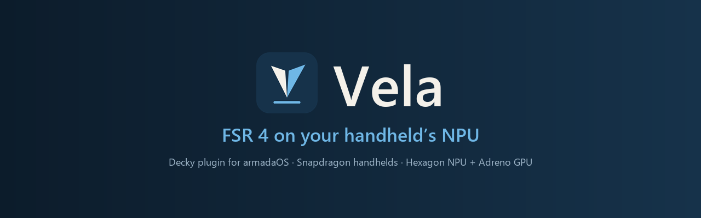
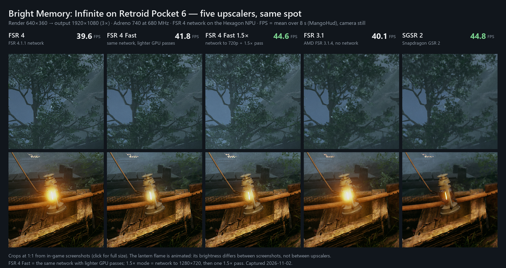
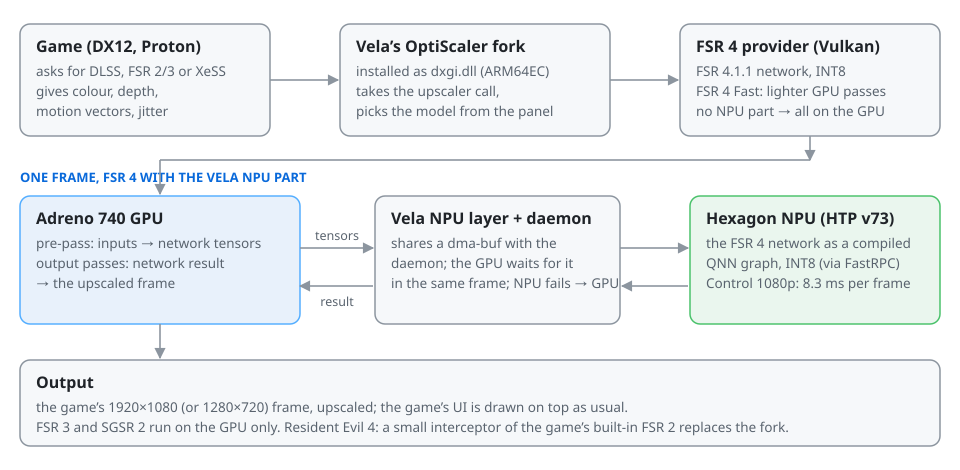

<div align="center">



[](LICENSE)
[](#supported-devices)
[](#supported-devices)
[](../../releases)
[](https://github.com/SteamDeckHomebrew/decky-loader)

[Install](#install) · [Tested games](#tested-games) · [How it works](#how-it-works) · [FAQ](#faq) · [Report a problem](#report-a-problem)

</div>

**Vela** is a [Decky Loader](https://github.com/SteamDeckHomebrew/decky-loader) plugin for **armadaOS** on Snapdragon handhelds.
It replaces a game's own upscaler (DLSS, FSR 2/3 or XeSS input) with **FSR 4**, the AMD FSR 4.1.1 network, which runs on the
**Hexagon NPU** when the Vela NPU system part is installed, or with **FSR 4 Fast**, **FSR 3** or **SGSR 2**, picked per game in
the Quick Access panel. Version **0.8.16** is an early public release: it works in the games listed below, and we keep improving it.

<p align="center">
  <a href="docs/compare.png"></a>
  <br><sub>Bright Memory: Infinite on Retroid Pocket 6, render 640×360 → 1920×1080, Adreno 740 at 680 MHz, camera still, crops at 1:1
  (click for full size). This capture runs every model at the same GPU clock, so its FPS differ from the gameplay table below.</sub>
</p>

## Features

| | |
|---|---|
| 🧠 **FSR 4 on the NPU** — the FSR 4.1.1 INT8 network runs on the Hexagon NPU as a compiled graph (Control 1080p: 8.3 ms per frame); without the NPU part it runs on the GPU | ⚡ **FSR 4 Fast** — the same network with lighter GPU passes, about 1.9× faster than FSR 4 on the GPU; a 1.5× mode for 1080p Ultra Performance by default |
| 🎮 **Works with DLSS, FSR 2/3 and XeSS inputs** — including DLSS with screen-size or jittered motion vectors (converted for FSR 4) | 🛠 **Game profiles** — Control, Resident Evil 4, Ghostrunner and Deep Rock Galactic get the in-game upscaler switched on for you (your own choice is kept) |
| 🔁 **Switch while playing** — change the model in the panel while the game runs; **Off** puts the game's own files back | 📱 **Chip detection** — SM8550 gets everything; SM8750 (Odin 3) gets FSR 4 on the GPU, FSR 3, SGSR 2; other chips are named in the panel |
| 🩺 **Report a problem** — one button collects an anonymised report (≤ 5 MB), shows you the files, and sends only when you press Send | 📖 **Open source** — GPL-3.0: the plugin, our OptiScaler fork (as patches), the RE4 interceptor, the NPU layer |

## Models

| model in the panel | what it is |
|---|---|
| **FSR 4** | the AMD FSR 4.1.1 network (INT8). Runs on the **Hexagon NPU** when the Vela NPU system part is installed, otherwise on the GPU |
| **FSR 4 Fast** | the same network in a cheaper mode, about twice as fast on the GPU. Also uses the NPU when it is there |
| **FSR 3** | FSR 3.1, no network |
| **SGSR 2** | Qualcomm Snapdragon Game Super Resolution 2, the lightest |
| **Off** | the game as Steam runs it; Vela puts the game's own files back |

## Supported devices

| device | chip | status |
|---|---|---|
| Retroid Pocket 6 | Snapdragon 8 Gen 2 (SM8550 / QCS8550, Adreno 740, HTP v73) | ✅ **tested** (all numbers below) |
| AYN Odin 2 / Odin 2 Mini / Odin 2 Portal / Thor | SM8550 | 🟡 expected to behave the same (same chip), **not tested** |
| AYN Odin 3 | Snapdragon 8 Elite (SM8750, Adreno 830, HTP v79) | 🟡 Vela detects the chip and offers **FSR 4 on the GPU, FSR 3 and SGSR 2**; no NPU and no FSR 4 Fast until an NPU package for HTP v79 exists. **Not tested on the device** |
| Retroid Pocket 5 / Retroid Pocket Mini and other SM8250 devices | Snapdragon 865 (SM8250) | 🟡 **partial, not tested**: plugin + FSR 3 + SGSR 2; FSR 4 not available (no compatible NPU) |
| any other or unknown chip | — | Vela names the chip in the panel, no NPU, no FSR 4 Fast |

**Requirements**

- **armadaOS** with Decky Loader (our test device: Armada 20261010, kernel 7.2.6, Mesa 26.2.4 Turnip, Decky 3.3.0).
- Games run through **Proton** (tested with Proton 11 ARM64) and must offer **DLSS, FSR 2/3 or XeSS** in their settings
  (Resident Evil 4: its FSR 2). Games without one of these have nothing for Vela to replace.
- DX12 games get every model; DX11-only games get SGSR 2 only.
- Optional: the **Vela NPU system part** for FSR 4 on the NPU (SM8550 only), see [Install](#install).

## Tested games

Tested on Retroid Pocket 6, 2026-11-02.

| game | what Vela replaces | result | measured |
|---|---|---|---|
| Resident Evil 4 | the game's FSR 2 (built into the exe) | ✅ **works**: FSR 4 on the NPU, 640×360 → 1280×720 | 42–43 FPS (the game's output was still 1280×720: set 1920×1080 in the game) |
| Control | DLSS / FSR 3.1 | ✅ **works**: profile sets output 1920×1080, render 960×540; FSR 4 on the NPU | 27.3 FPS, 1 % low 23.4 (FSR 4) |
| Bright Memory: Infinite | FSR 2 / FSR 3.1 / **DLSS** | ✅ **works** with FSR 2 and with DLSS (DLSS's screen-size motion vectors are converted for FSR 4) | see FPS table |
| Into the Dead: Our Darkest Days | DLSS / FSR 3.1 | ✅ **works**: FSR 4 on the NPU, 672×378 → 1920×1080 | 38.8 FPS (FSR 4), 43.0 (SGSR 2) |
| Deep Rock Galactic | DLSS / FSR 2 | ✅ **works**: profile switches the game's upscaler on; FSR 4 1130×636 → 1920×1080 | 66.7 FPS (FSR 4), 103.2 (SGSR 2), menu scene |
| Ghostrunner | DLSS | ❌ **not working**: Vela turns DLSS on in the game's config, but the game never creates its DLSS upscaler, so nothing is replaced | 22 FPS at 1080p without an upscaler |
| Cyberpunk 2077 | — | ⛔ **do not use**: the game hangs the GPU in about half of the launches **even without Vela** (a Turnip / vkd3d-proton issue; we are sending our data to the Armada developers) | — |
| Godot games (e.g. Sir, We Have an Orc Problem) | — | **unsupported**: FSR 2 is part of the engine; Vela detects Godot and says so | — |
| Unity games without DLSS / FSR / XeSS (DREDGE, TUNIC, Tape to Tape) | — | **unsupported**: nothing to replace | — |
| Online games with anti-cheat | — | **unsupported** on purpose (ban risk) | — |

Other games with DLSS / FSR 2–3 / XeSS may work; they are not tested yet. Please [report](#report-a-problem) what you find.

### FPS we measured

Conditions: Retroid Pocket 6, armadaOS 20261010, Proton 11 ARM64, Vela NPU system part installed, average and (1 % low) over
8 s from mangoapp, Vela's GPU clock floor active (the GPU clock differed between some runs, noted where it did).
Different scenes per game; **numbers compare models inside one row only**.

| game, input, render → output | FSR 4 | FSR 4 Fast | SGSR 2 | note |
|---|---|---|---|---|
| Control, DLSS/FSR, 960×540 → 1920×1080 | 27.3 (23.4) | — | — | gameplay; NPU 8.3 ms per frame |
| RE4, game FSR 2, 640×360 → 1280×720 | 42–43 | — | — | interceptor's own FPS line; FSR 4 GPU part 1.87 ms |
| Bright Memory, FSR 2 Ultra Perf., 427×240 → 1280×720 | 44.0 (39.4) | **54.2** (37.4) | 53.9 (42.4) | gameplay; Fast uses its 1.5× mode by default |
| Bright Memory, FSR 2 Ultra Perf., 640×360 → 1920×1080 | 35.5 (30) | 42.3 (22–29)\* | 46.1 (40–42) | \*Fast without its 1.5× mode; FSR 4 at 550 MHz, the others at 680 MHz |
| Bright Memory, DLSS, 853×480 → 1280×720 | — | 54.7 (41.8) | 60.6 (46.3) | Fast at 550 MHz, SGSR 2 at 680 MHz |
| Into the Dead, 672×378 → 1920×1080 | 38.8 (23–24) | — | 43.0 (22–26) | shelter scene, 680 MHz |
| Deep Rock Galactic, 1130×636 → 1920×1080 | 66.7 (56.0) | — | 103.2 (98.2) | welcome screen, 475 vs 680 MHz: rough |

FSR 3 is offered in the panel; it was not re-measured in a game for this release.

## Install

> [!NOTE]
> When Vela is in the **Armada Store**, installing from the Store is the easier way. Until then, install the zip by hand.

**1. The plugin**

1. Download `vela-0.8.16.zip` from the [Releases](../../releases) page and check it:
   ```sh
   md5sum vela-0.8.16.zip
   # must print: 11d684e137ea0e0f4d8777ffe5731253
   ```
2. In Decky: gear icon → **Developer** (developer mode on) → **Install Plugin from ZIP File** → pick the zip.
   (Or **Install Plugin from URL** with the release file's URL.)
3. Vela appears in the Quick Access menu as **Vela**.

**2. Optional: the Vela NPU system part** (FSR 4 on the NPU; SM8550 only)

```sh
curl -fsSL https://github.com/zrprod9-cmyk/vela/releases/download/v0.8.16/install-vela-npu.sh | sudo sh
```

It is two systemd system extensions in `/var/lib/extensions` (nothing in armadaOS is overwritten): our image
`vela-npu-sysext-12.raw` (the NPU daemon, 7 compiled FSR 4 graphs, FastRPC, units, a udev rule that gives the `render` group
access to `/dev/fastrpc-cdsp`, and the Qualcomm AI Engine Direct (QNN) runtime 2.47.0.260601, unmodified) and the DSP shell + C++ runtime, which the installer reads from your device's own dsp partition. No Qualcomm download is
needed; `sudo` is needed once. Details, file list and removal: [npu/README.md](npu/README.md). Without it Vela runs FSR 4 and
FSR 4 Fast on the GPU; the panel says which part is missing (not installed / installed incompletely / service not running).

<details>
<summary><b>Update, rollback and removal</b></summary>

- **Update:** install the new zip the same way; Decky replaces the old version. Vela re-checks the files it put into each game
  the next time the game is shown in the panel while it is closed.
- **Go back a version:** install the older zip the same way.
- **Take Vela out of a game:** open the game's page, Vela panel → **Off**. Vela restores the game's own files from its backup
  and its launch options.
- **Remove the plugin:** first set every game to **Off**, then uninstall Vela in Decky. Uninstalling alone does not touch the
  files Vela put into game folders.

</details>

## Usage

1. Select the game in the Steam library (or start it) and open Quick Access → **Vela**. The panel shows the game, what runs
   now, and the model buttons.
2. **Pick a model.** If the game is running, restart it once: the files are put in place before the next start.
3. **In the game's own settings choose the upscaler** and quality preset that the panel's note names (for example
   "choose FSR 3.1 or DLSS"). Vela reads the game's input and replaces its output. For **Control, Resident Evil 4,
   Ghostrunner and Deep Rock Galactic** Vela's game profile writes this setting into the game's config file for you
   (only when the game has it switched off; your own choice is kept).
4. For games with several launch entries in Steam (DX11 / DX12) choose **DX12** when Steam asks.
5. You can switch the model while the game runs; the speed is set by the game's quality preset
   (Performance, Ultra Performance …).
6. While a game with Vela runs, Vela raises the GPU's minimum clock and puts it back when the game closes.

## How it works

<picture>
  <source media="(prefers-color-scheme: dark)" srcset="docs/how-it-works-dark.svg">
  <source media="(prefers-color-scheme: light)" srcset="docs/how-it-works-light.svg">
  
</picture>

Vela does this through its own fork of [OptiScaler](https://github.com/optiscaler/OptiScaler) (based on the ARM64EC build
[justradical/Sloptiscaler](https://github.com/justradical/Sloptiscaler)), a Vulkan FSR 4 provider, a Vulkan layer that hands
the FSR 4 network to the NPU, and, for Resident Evil 4, a small interceptor of the FSR 2 the game has built in. If the NPU does
not answer in time, that frame's network runs on the GPU, so the game does not hang on the NPU.

## Report a problem

Vela panel → **Report a problem** → pick a reason (crashed / FSR does not work / bad picture / slow / other), add a short text
→ **Collect report** → you see the list of files and their sizes → **Send**. You get a number **`VELA-XXXXXX`**; please quote it
when you [open an issue](../../issues/new/choose). After a run that went wrong (GPU hang, upscaler did not start, a very short
run) Vela asks once whether to send a report: Yes / No / Don't ask again. At most 3 reports per hour; a report is at most 5 MB.

## FAQ

<details>
<summary><b>Why the NPU?</b></summary>

The network is the heaviest part of FSR 4. The Snapdragon 8 Gen 2 has a Hexagon NPU made for INT8 networks, and FSR 4's
network is INT8, so Vela compiles it into a QNN graph and runs it there (Control at 1080p: 8.3 ms per frame on the NPU; the
1080p Ultra Performance graph went from 10.86 to 7.45 ms in NPU package 12). Without the NPU part FSR 4 runs on the GPU.
We have not published an NPU vs GPU FPS comparison yet.
</details>

<details>
<summary><b>Is it exactly AMD's FSR 4?</b></summary>

The **FSR 4** model runs the AMD FSR 4.1.1 INT8 network through a Vulkan provider built from
[dvj5411/fsr4vk](https://github.com/dvj5411/fsr4vk); on the NPU the same network runs as a compiled QNN graph. **FSR 4 Fast**
uses the same network with lighter GPU passes around it, so its picture differs slightly from FSR 4. It is not an official
AMD product.
</details>

<details>
<summary><b>What about battery life?</b></summary>

Not measured yet. While a game with Vela runs, Vela raises the GPU's minimum clock (and puts it back when the game closes),
which keeps the frame rate steadier and can cost some battery.
</details>

<details>
<summary><b>Does it work on the AYN Odin 3?</b></summary>

Vela detects the Snapdragon 8 Elite and offers FSR 4 on the GPU, FSR 3 and SGSR 2. There is no NPU path and no FSR 4 Fast
until an NPU package for HTP v79 exists. Not tested on the device; reports are welcome.
</details>

<details>
<summary><b>Cyberpunk 2077?</b></summary>

Do not use it with Vela for now: the game hangs the GPU in about half of the launches **even without Vela** (a Turnip /
vkd3d-proton issue). Vela's profile sets `VKD3D_CONFIG=no_upload_hvv` and `Spoofing.Dxgi=false`; they do not fix the hang.
We are sending our data to the Armada developers.
</details>

## Known issues

- **NPU part**: the public installer was run on a Retroid Pocket 6 with a local copy of the image (`--image`; 7 of 7 NPU
  daemons OK); its download step from the release is new. The image (sha256 `392ba27e…a52a`) carries the Qualcomm QNN runtime.
- **Control looks washed out on SDR**: Vela's Control profile turns the game's HDR on, and the game then outputs scRGB.
  Possible workaround (not tested by us): switch HDR off in Control's settings. A profile fix is planned.
- **Control sometimes exits on the title screen** (about 1 launch in 5 in our runs): the crash is inside the game's own
  code, none of Vela's files are in the call stack; start it again.
- **Ghostrunner**: no FSR 4 (see the table).
- **Cyberpunk 2077**: GPU hang about every second launch, with or without Vela.
- Kernel log lines `gpu fault ... TRANSLATION` appear 0–2 s after FSR 4 starts in some games (Bright Memory, Into the Dead);
  the games kept running. The same lines also appear without Vela (Cyberpunk). Into the Dead hung the GPU once in its main
  menu in one of our runs.
- Bright Memory: in one session gamescope crashed twice right after launching the game; later sessions started normally.
- The Decky **OptiScaler** plugin and Vela must not be used on the same game: the other plugin's uninstall removes files
  Vela needs. Vela restores its files when the game is shown in the panel while closed.
- The first start after picking a model in a running game uses the old files; restart the game.
- Uninstalling Vela does not restore games: set them to **Off** first.

## Privacy

Vela never sends anything on its own. The «Report a problem» button (and the question after a game run that went wrong)
collects a report: the OptiScaler/Vela run log, the NPU layer log, Vela's settings for this game, the Steam launch options, the
plugin, OS, Mesa and Proton versions, and the kernel's GPU lines and gamescope lines from the time of the run. Before sending,
the report is stripped of your home path, user and device names, Steam IDs and account names, e-mail, IP and MAC addresses,
and anything that looks like a token or password. Saves, screenshots and account files are never included. You see the file
list and decide whether to send. The report goes through our relay (Cloudflare) to the developers' private Telegram chat and is
not stored anywhere else; a copy stays on your device in `~/homebrew/settings/upscale/reports`. We use reports only to fix Vela.
To have a sent report deleted, send us its `VELA-…` number.

## Source and licences

| folder | what | licence |
|---|---|---|
| `plugin/` | the Decky plugin (Python backend, TypeScript panel; texts in `plugin/src/i18n/en.json`, English only) | GPL-3.0-only |
| `fork/` | our OptiScaler fork as patches on Sloptiscaler `f80e4da3` (OptiScaler 10.0.0.1, ARM64EC) with build steps, see [fork/README.md](fork/README.md) | GPL-3.0, like OptiScaler |
| `interceptor/` | the Resident Evil 4 interceptor of the game's FSR 2 | GPL-3.0-only; Microsoft Detours: MIT |
| `npu-layer/` | the Vulkan layer that hands the FSR 4 network to the NPU daemon | GPL-3.0-only |
| `npu/` | the Vela NPU system part: image builder, installer, uninstaller ([npu/README.md](npu/README.md)) | see [LICENSING.md](LICENSING.md) |

Licensing of the plugin's own code and of each bundled binary: [LICENSING.md](LICENSING.md),
[THIRD_PARTY_NOTICES.md](THIRD_PARTY_NOTICES.md).

### Qualcomm runtime in the NPU part
The NPU part (`vela-npu-sysext-12.raw`) includes 6 unmodified files of the Qualcomm AI Engine Direct (QNN) runtime
2.47.0.260601, as part of Vela only; they are not offered as separate downloads. Qualcomm's licence (the Qualcomm AI Stack
License) and its Notice File ship unchanged in the image at `/usr/share/licenses/armada-vela-npu/`
(`Qualcomm-AI-Stack-LICENSE.pdf`, `QNN_NOTICE.txt`). Export control: see section 10(f) of that licence. No Qualcomm SDK
header is in this repository; `fsr4npud` is GPL-3.0-or-later with a linking permission for the Qualcomm runtime
(`LICENSING.md`).

## Contributing

- **Bugs:** press **Report a problem** in the panel first, then [open an issue](../../issues/new/choose) with the `VELA-XXXXXX`
  number, your device, the game and the model.
- **A game that works (or does not):** open an issue with the game, its upscaler setting, the model and the FPS you see.
- **Code:** build the plugin with `pnpm install && pnpm build`, then `build_zip.py`; run the tests with
  `python tests/test_<name>.py` for each file in `plugin/tests`. Pull requests follow the
  [template](.github/PULL_REQUEST_TEMPLATE.md).

## Credits

- **OptiScaler** team — the upscaler bridge everything here is built on: https://github.com/optiscaler/OptiScaler
- **justradical / Sloptiscaler** — the ARM64EC OptiScaler build with SGSR 2 that our fork starts from:
  https://github.com/justradical/Sloptiscaler
- **AMD** — FSR 4, FSR 3 and the FidelityFX SDK; **dvj5411/fsr4vk** — the Vulkan FSR 4 provider our provider is built from.
- **Qualcomm** — Snapdragon Game Super Resolution (SGSR 2).
- **OptiPatcher**, **fakenvapi**, **LatencyFleX** — bundled inside or next to the fork (see the notices).
- **armadaOS / Armada developers** — the OS, Turnip builds and the Armada Store this runs on.
- **Decky Loader** (Steam Deck Homebrew) — the plugin system and the plugin template.

<sub>Vela is an independent project. FSR is a trademark of AMD, Snapdragon and Hexagon are trademarks of Qualcomm, DLSS is a
trademark of NVIDIA; Vela is not affiliated with or endorsed by them.</sub>
